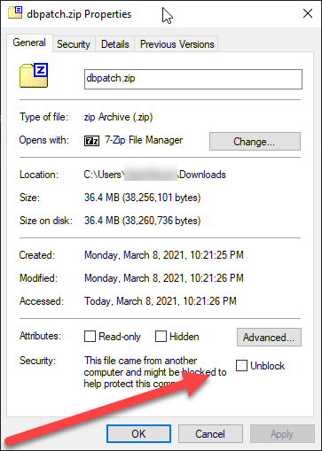

# Tutorial

## Introduction

dbpatch is a tool for database change management. The purpose of the tool is to manage database change patches and code assets. These patches and code assets can then be added to and modified in multiple source control branches, merged, and applied to a database in the proper order.

## Installing

Before using dbpatch, it must be installed on a workstation or server.

dbpatch is compiled on .NET 8 which is cross platform and runs on Windows, Linux, and macOS.

### Installing on Windows

dbpatch doesn't yet have a working distribution package or MSI for Windows. Instead use the following instructions.

[.NET 8 runtime](https://dotnet.microsoft.com/download/dotnet/8.0) is a requirement that must be installed before dbpatch can be used.

1. Download the zip from the latest [Release](https://github.com/ormico/dbpatchmanager/releases/latest/download/dbpatch.zip).
2. Right click on the zip in Explorer and open the Properties dialog. Click the checkbox to Unblock the zip and then click OK. If you do not see an Unblock checkbox near the bottom of the dialog, then click OK and go to the next step.
3. Unzip the zip file into a folder where you wish to install it. For example `C:\Program Files\dbpatch`
4. Add the folder to your PATH.



### Installing on Linux

dbpatch can be installed using the included install shell script from the latest release, or you can download and review the script before running.

#### Prerequisites

* [.NET 8 runtime](https://dotnet.microsoft.com/download/dotnet/8.0)
* [wget](https://www.gnu.org/software/wget/)
* unzip

#### Quick install

Using `wget`, the install shell script can be downloaded and piped to bash:

```bash
wget -qO- https://github.com/ormico/dbpatchmanager/releases/latest/download/install-dbpatch.sh | sudo bash
```

#### Manual install (review first)

Download the script, review it, then execute:

```bash
# Download install script
wget -q https://github.com/ormico/dbpatchmanager/releases/latest/download/install-dbpatch.sh -O install-dbpatch.sh

# Review before executing
cat install-dbpatch.sh

# Make executable and run
chmod +x install-dbpatch.sh
sudo ./install-dbpatch.sh

# Cleanup
rm install-dbpatch.sh
```

If you install dbpatch to a location other than `/usr/local/lib/dbpatch`, you may need to modify the wrapper script at `/usr/local/lib/dbpatch/dbpatch`. This shell script wraps the call to `dotnet dbpatch.dll`.

For versions v2.1.1 and later, each release includes a version-specific install script.

### Installing on macOS

The Linux installation instructions work on macOS as well. Install the [.NET 8 runtime](https://dotnet.microsoft.com/download/dotnet/8.0), then use either the quick install or manual install steps from the Linux section above.

## Our Example Developers

In this tutorial, we are going to simulate a multi-developer team working in git and SQL Server. To simulate the team collaborating together in git, we will check the changes attributed to each of our imaginary team members into a different branch.

Our Imaginary Team:

* **Ann** — working on user login and privilege system
* **Bettie** — working on order tracking system
* **Casey** — initial project setup and PR review/merge

## Creating a New Project (SQL Server)

To get started, create a folder for your database project and run `dbpatch init` with the `--dbtype` parameter. Supported database types include `sqlserver`, `mysql`, `sqlite`, `odbc`, and `test`. For this example, we use SQL Server:

```bash
mkdir mydb
cd mydb
git init
dbpatch init --dbtype sqlserver
```

The `init` command also accepts optional folder name overrides:

* `--patchFolder <name>` — folder for patch directories (default: `"Patches"`)
* `--codeFolder <name>` — folder for stored procedures, functions, and triggers (default: `"Code"`)

For example: `dbpatch init --dbtype sqlite --patchFolder Migrations --codeFolder Scripts`

This creates the following structure:

* A `Code/` folder for stored procedures, triggers, views, and other executable database objects.
* A `Patches/` folder to hold each change script directory.
* A `patches.json` file containing the configuration and patch dependency graph (see [Creating the First Patches](#creating-the-first-patches) below).

### Create an empty database

dbpatch requires that a database exists for it to connect to. dbpatch will not create the database for you if it does not exist.

In our example, we are using `sqlcmd` from the command line to create our example databases, but any SQL Server tool that can execute scripts will work. Execute the following from the command line:

```bash
sqlcmd -S . -Q "create database [dbpatch-example-ann]"
sqlcmd -S . -Q "create database [dbpatch-example-bettie]"
sqlcmd -S . -Q "create database [dbpatch-example-casey]"
```

Because we have three developers on our team, let's give each of them their own database to work in. This simulates each of them having a local database on their own workstation.

### Setting the database connection string

dbpatch's configuration system supports splitting the configuration information into two files. In the previous step, we created `patches.json` using the `init` command.

In this step, we are going to create the second file `patches.local.json`. Where `patches.json` is checked into source control, `patches.local.json` is designed **not** to be checked in. The local file is where workstation or server specific settings are specified. When dbpatch runs, these two configuration files are merged with `patches.local.json` overriding any settings made in `patches.json`. While you can override any setting, typically the `ConnectionString` is the most common setting used in the local file.

Create a file in the database project folder named `patches.local.json`. The contents of the file should look like the following, but with your actual connection string:

```json
{
    "ConnectionString": "Server=.;Database=dbpatch-example-casey;Trusted_Connection=True;"
}
```

For our imaginary team, let's create a separate local file for each developer. We can swap this file in and out as we simulate commands for each individual. Create the following three files using the correct connection strings for your workstation:

**`patches.ann-local.json`**

```json
{
    "ConnectionString": "Server=.;Database=dbpatch-example-ann;Trusted_Connection=True;"
}
```

**`patches.bettie-local.json`**

```json
{
    "ConnectionString": "Server=.;Database=dbpatch-example-bettie;Trusted_Connection=True;"
}
```

**`patches.casey-local.json`**

```json
{
    "ConnectionString": "Server=.;Database=dbpatch-example-casey;Trusted_Connection=True;"
}
```

### Ignoring patches.local.json and checking in changes to source control

The file `patches.local.json` should be added to `.gitignore` to prevent it from being checked in. In addition to containing sensitive login information, `patches.local.json` is used to customize the connection for each environment.

For this example we also want to ignore the other patches local files we created for each imaginary team member.

Create a `.gitignore` file that contains the following entries:

```
patches.local.json
patches.ann-local.json
patches.bettie-local.json
patches.casey-local.json
```

Check in the files we have created so far (except for the ones that are ignored):

```bash
git add -A
git commit -m "init dbpatch project"
```

## Creating the First Patches

Ann starts by creating her first database patch. Run `dbpatch addpatch` with a `-n` (name) flag:

```bash
dbpatch addpatch -n initial-setup
```

This creates a new folder in the `Patches/` directory named using the pattern `{yyyyMMddHHmm}-{random4digits}-{name}`. For example:

```
202610241030-1408-initial-setup
```

The command also adds an entry to `patches.json` with a dependency graph. After this first patch, `patches.json` looks like:

```json
{
    "DatabaseType": "sqlserver",
    "ConnectionString": null,
    "PatchFolder": "Patches",
    "CodeFolder": "Code",
    "CodeFiles": [
        "*.view.sql",
        "*.udf.sql",
        "*.view2.sql",
        "*.udf2.sql",
        "*.view3.sql",
        "*.udf3.sql",
        "*.sproc.sql",
        "*.sproc2.sql",
        "*.sproc3.sql",
        "*.trigger.sql",
        "*.trigger2.sql",
        "*.trigger3.sql"
    ],
    "patches": [
        {
            "id": "202610241030-1408-initial-setup",
            "dependsOn": null
        }
    ]
}
```

### Git workflow for patches

Always create a new branch for each developer's database changes. Ann checks out her feature branch:

```bash
git branch ann/user-login-system
git checkout ann/user-login-system
```

Ann adds her SQL files to the patch folder (e.g., `Patches/202610241030-1408-initial-setup/create-users-table.sql`), stages, and commits:

```bash
git add -A
git commit -m "add initial database schema"
```

### Building the Database after Schema Additions

Now that Ann has created her first patch, she can apply it to her database. Run `dbpatch build`:

```bash
dbpatch build
```

The build process:

1. Reads `patches.json` from the current directory (throws an error if missing).
2. Identifies the starting patch — the one with no dependencies (`dependsOn: null`). If zero or multiple patches have no dependencies, `build` throws an error.
3. Connects to the database using the connection string from `patches.local.json`.
4. Walks the dependency graph, applying each uninstalled patch in order.
5. Executes all `.sql` files within each patch folder (alphabetical order).
6. Records installed patches in the `InstalledPatches` table.

Expected output:

```
202610241030-1408-initial-setup
C:\mydb\Patches\202610241030-1408-initial-setup\create-users-table.sql
```

Each line shows a patch being applied, followed by the SQL files within that patch.

## Merging Schema Changes from Another User

Now let's simulate Bettie working on her own branch and then Casey merging both developers' changes.

### Bettie creates her patch

Bettie checks out her feature branch and creates a patch:

```bash
git checkout -b bettie/order-tracking
dbpatch addpatch -n create-orders-table
```

Her `patches.json` now has two patches — the dependency graph branches because both Ann's and Bettie's first patches depend on nothing (they were created from separate branches).

### Casey merges both branches

Casey, acting as the PR reviewer, merges both feature branches into main:

```bash
git checkout main
git merge ann/user-login-system --no-edit
git merge bettie/order-tracking --no-edit
```

After merging, `patches.json` contains entries from both branches. The dependency graph now looks like:

```json
{
    "DatabaseType": "sqlserver",
    "ConnectionString": null,
    "PatchFolder": "Patches",
    "CodeFolder": "Code",
    "CodeFiles": [
        "*.view.sql",
        "*.udf.sql",
        "*.sproc.sql"
    ],
    "patches": [
        {
            "id": "202610241030-1408-initial-setup",
            "dependsOn": null
        },
        {
            "id": "202610241100-2205-create-orders-table",
            "dependsOn": ["202610241030-1408-initial-setup"]
        }
    ]
}
```

The `dbpatch` merge logic preserves the dependency tree from each branch. Patches that existed only in one branch retain their dependencies within that branch's history.

### Casey builds with merged patches

Casey runs build to apply all newly merged patches:

```bash
dbpatch build
```

`dbpatch build` walks the full dependency graph and applies any patches not yet installed, respecting the correct order across both branches.

## Examining the InstalledPatches Table

After building, you can verify which patches have been applied by querying the `InstalledPatches` tracking table. The SQL Server plugin stores patch IDs and installation timestamps:

```bash
sqlcmd -S . -d dbpatch-example-casey -Q "SELECT PatchId, InstalledDate FROM InstalledPatches ORDER BY InstalledDate DESC"
```

The `ORDER BY InstalledDate DESC` clause shows the most recently installed patches first. Columns returned:

* **`PatchId`** — the unique identifier of the applied patch (matches the folder name in `Patches/`)
* **`InstalledDate`** — when the patch was applied to this database

> **Note:** The exact query and table schema depend on your database plugin. SQL Server uses `sqlcmd`; MySQL and SQLite have their own CLI tools.

## Creating the First Database Code Entries

Patches are one-time schema changes. Database code items — stored procedures, functions, views, and triggers — are re-applied on every `dbpatch build`. This ensures that if a developer modifies a stored procedure, running build again updates it in the database.

Code files go in the `Code/` folder (or whatever you specified with `--codeFolder`). The file extension determines when during load order the SQL executes.

### Stored Procedures

Create a stored procedure by adding a `.sproc.sql` file to the `Code/` folder:

```sql
-- Code/my-users-sproc.sproc.sql
CREATE PROCEDURE [dbo].[GetUser]
    @UserId INT
AS
BEGIN
    SELECT Id, Username, Email FROM Users WHERE Id = @UserId
END
```

The `.sproc.sql` extension tells dbpatch to load this as a stored procedure. If you have more than one stored procedure file, they are loaded in alphabetical order by filename.

### User Defined Functions

Create a user-defined function with the `.udf.sql` extension:

```sql
-- Code/get-full-name.udf.sql
CREATE FUNCTION [dbo].[GetFullName]
    (@UserId INT)
RETURNS NVARCHAR(100)
AS
BEGIN
    DECLARE @Name NVARCHAR(100)
    SELECT @Name = FirstName + ' ' + LastName FROM Users WHERE Id = @UserId
    RETURN @Name
END
```

### User Defined Functions with Dependencies

If a function depends on another function, use the numbered extensions. `.udf.sql` loads first, then `.udf2.sql`, then `.udf3.sql`:

```sql
-- Code/get-user-info.udf2.sql  (loads after get-full-name.udf.sql)
CREATE FUNCTION [dbo].[GetUserInfo]
    (@UserId INT)
RETURNS NVARCHAR(200)
AS
BEGIN
    DECLARE @Info NVARCHAR(200)
    SELECT @Info = dbo.GetFullName(@UserId) + ' | ' + Email FROM Users WHERE Id = @UserId
    RETURN @Info
END
```

### Triggers

Create triggers with the `.trigger.sql` extension. Like stored procedures, numbered variants (`.trigger2.sql`, `.trigger3.sql`) control load order:

```sql
-- Code/user-audit-trigger.trigger.sql
CREATE TRIGGER [dbo].[UserAuditTrigger]
ON Users
AFTER INSERT, UPDATE, DELETE
AS
BEGIN
    -- Audit logging logic here
END
```

### Complete code file load order

dbpatch applies code files in this fixed sequence:

| Order | Extension | Purpose |
|-------|-----------|---------|
| 1 | `*.view.sql` | Views (base) |
| 2 | `*.udf.sql` | User-defined functions (base) |
| 3 | `*.view2.sql` | Views (dependent on base udf) |
| 4 | `*.udf2.sql` | Functions (dependent on base udf) |
| 5 | `*.view3.sql` | Views (dependent on udf2) |
| 6 | `*.udf3.sql` | Functions (dependent on udf2) |
| 7 | `*.sproc.sql` | Stored procedures (base) |
| 8 | `*.sproc2.sql` | Stored procedures (dependent) |
| 9 | `*.sproc3.sql` | Stored procedures (dependent) |
| 10 | `*.trigger.sql` | Triggers (base) |
| 11 | `*.trigger2.sql` | Triggers (dependent) |
| 12 | `*.trigger3.sql` | Triggers (dependent) |

Within each extension group, files load in alphabetical order by filename.

### Building the Database after Code Additions

After adding code files to `Code/`, run build again:

```bash
dbpatch build
```

Unlike patches (which run once), code files are re-applied on every build. This means if you modify a stored procedure and rebuild, the updated version is executed against the database. Expected output:

```
202610241030-1408-initial-setup: already installed
Installing: C:\mydb\Code\get-full-name.udf.sql
Installing: C:\mydb\Code\get-user-info.udf2.sql
Installing: C:\mydb\Code\my-users-sproc.sproc.sql
Installing: C:\mydb\Code\user-audit-trigger.trigger.sql
```

The patch is shown as "already installed" while all code files are listed under "Installing."

## Merging Code Entries

When multiple developers modify the same code file across branches, git handles the merge just like any other text file. If Ann and Bettie both edit `Code/my-users-sproc.sproc.sql` on different branches, a merge conflict may occur.

### Resolving code conflicts

1. After merging, if git reports a conflict in a `.sproc.sql` or similar file, resolve it manually in your editor.
2. Stage the resolved file: `git add Code/my-users-sproc.sproc.sql`
3. Complete the merge commit: `git commit -m "resolve sproc merge conflict"`

### Rebuilding after code merge

After resolving any conflicts, run build to apply the merged code files:

```bash
dbpatch build
```

All code files are re-applied regardless of whether they changed, ensuring the database reflects the final merged state.

## Deploying Changes to Production

Deploying database changes to production follows the same `dbpatch build` command, but with a different connection string and workflow considerations.

### Step 1: Merge all approved patches

Ensure all feature branches have been merged into your deployment branch (typically `main`):

```bash
git checkout main
git pull origin main
```

Verify that `patches.json` contains all expected patches by reviewing the dependency graph.

### Step 2: Update the connection string

For production, override the connection string in `patches.local.json`:

```json
{
    "ConnectionString": "Server=prod-server;Database=MyApp;User Id=dbpatch_user;Password=***;"
}
```

Never commit `patches.local.json` to source control. Each environment (development, staging, production) uses its own local config file or environment-specific override.

### Step 3: Run build against production

```bash
dbpatch build
```

The build process applies all uninstalled patches in dependency order and refreshes all code files.

### Safety considerations

* **Backup first:** Always back up the production database before running `dbpatch build`.
* **Review patches:** Inspect each patch folder under `Patches/` to review the SQL that will execute.
* **Test in staging:** Run `dbpatch build` against a staging database that mirrors production before deploying live.
* **Rollback plan:** Keep the previous version of `patches.json` and be prepared to manually reverse DDL changes if something goes wrong. dbpatch does not have an automatic rollback feature.

## Conclusion

This tutorial covered the complete dbpatch workflow:

* **Installation** — Setting up dbpatch on Windows, Linux, or macOS using .NET 8 runtime.
* **Project initialization** — Creating a new project with `dbpatch init --dbtype <database>`.
* **Patch management** — Adding patches with `dbpatch addpatch -n <name>` and managing them across git branches.
* **Building the database** — Applying patches and code files with `dbpatch build`.
* **Multi-developer collaboration** — Merging patch dependency graphs from separate feature branches.
* **Database code items** — Managing stored procedures, functions, views, and triggers in the `Code/` folder.
* **Production deployment** — Safely applying changes to production databases.

### Next steps

* Read the [README](../README.md) for a quick reference of all commands.
* Explore [database plugins](https://github.com/ormico/dbpatchmanager-sqlserver) for MySQL, SQLite, and other database types.
* Check the [GitHub repository](https://github.com/ormico/dbpatchmanager) for issues, feature requests, and contributions.
